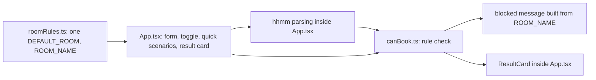
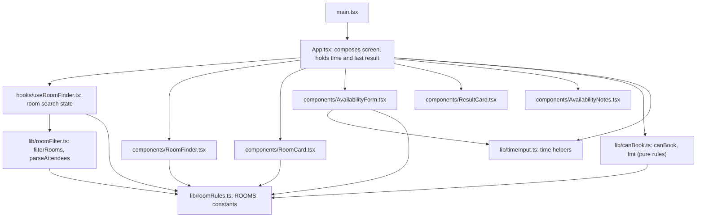

# Assignment #04 Report: Smart Campus Room Availability Checker

Scope: AI-assisted software evolution of the Assignment 03 app. This report covers the analysis, the feature extension (rooms, filters, room switching), the refactor, the test evidence, and a before/after quality comparison.

Evidence labels used in this report:
- **Executed**: the command was run in this environment and its output is saved in `TEST_RESULTS.txt`.
- **Read from source**: confirmed by reading or searching the current source files.
- **Recalled**: taken from the first analysis session; the original file is not saved in this project, so it cannot be re-run.
- **Not verified**: not checked by a browser test or a human reviewer.

---

## 1. Task #01: Repository analysis

### 1.1 Repository map (original, before Task #02)

| File | Responsibility |
|---|---|
| `src/App.tsx` | Entire single-screen UI: room card, time form, quick scenarios, result card, notes |
| `src/lib/canBook.ts` | Pure `canBook()` rule check and `fmt()` time formatter |
| `src/lib/roomRules.ts` | Constants (`ROOM_NAME`, `MAX_DURATION`, `MINUTES_PER_DAY`) and one fictional room (`DEFAULT_ROOM`) |
| `src/lib/canBook.spec.ts` | Unit tests for `canBook` and `fmt`, grouped by acceptance criterion |
| `src/lib/canBook.boundaries.spec.ts` | Boundary tests with frozen inputs |
| `src/App.spec.tsx` | UI smoke tests |
| `src/test/setup.ts` | Loads jest-dom matchers |
| `src/main.tsx` | Mounts `App` in StrictMode |
| `AGENTS.md` | Project rules for changes |

Baseline test count by inspection (not executed in that state): 67 tests in three files (46 + 16 + 5).

### 1.2 Maintainability risks

1. **Single-room data is hard-wired.** `src/lib/roomRules.ts` exports one `ROOM_NAME` and one `DEFAULT_ROOM`. `canBook()` in `src/lib/canBook.ts` (blocked branch, around line 117) builds its blocked message from `ROOM_NAME`, so it cannot name another room. The room name was also rendered directly in `App.tsx`.
2. **`App.tsx` is a monolith.** The `App` function (lines 41 to 348) mixes time parsing (`hhmmToMinutes`, `minutesToHHMM`, `clampMinute`, lines 19 to 39), form state, the blocked toggle, inline quick-scenario data (lines 297 to 303), the result card, and layout. Six `useState` hooks and about seven handlers each call `setResult(null)` by hand, so a new control can forget to clear results.
3. **Minute input is clamped on every keystroke.** `setStartMMSafe` and `setEndMMSafe` pass the value through `clampMinute`, which turns an empty or non-numeric minute into `"00"` immediately. Users cannot clear the field and type a new value.
4. **Tests carry misleading titles and duplicate helpers.** In `canBook.spec.ts`, one title said "accepts ... start=0 only when now<0" while the test asserted rejection, and another said "returns blocked even when start is in the past" while testing a valid future slot. `canBook.boundaries.spec.ts` defines `frozenRoom`, which duplicates `room()` in `canBook.spec.ts`, and several AC4 and AC5 cases appear in both files.
5. **Circular type import.** `roomRules.ts` imports the `RoomState` type from `canBook.ts`, and `canBook.ts` imports constants from `roomRules.ts`.
6. **Unused dependency.** `package.json` lists `@supabase/supabase-js`, which no source file imports. It was left in place because the assignment forbids a backend.

### 1.3 Prioritized improvement plan

1. Add a room catalog with IDs, capacities, equipment, blocked status, and independent bookings. Keep the original room unchanged. **Done in Task #02.**
2. Add a pure filter for capacity and equipment, kept separate from the availability rules. **Done in Task #02.**
3. Handle room-specific blocked wording in the UI so `canBook()` keeps its signature. **Done in Task #02.**
4. Split `App.tsx` into components, move room search state into a hook, and move time helpers into their own module. **Done in Task #03.**
5. Tidy misleading test titles. **Done for two titles in Task #03. Duplicate helpers were not merged.**
6. Fix the minute-field clearing behavior (risk 3). **Not done.**
7. Remove the unused Supabase dependency or confirm it is needed. **Not done; needs your decision.**
8. Break the circular type import (risk 5). **Not done.**

### 1.4 Reusable and new tests

- Reused as-is: all 46 `canBook.spec.ts` tests and all 16 `canBook.boundaries.spec.ts` tests, because `canBook()` did not change.
- Reused with additions: the 5 original `App.spec.tsx` tests. The file gained 6 tests for the new behavior.
- Added: tests for filtering, the room catalog, and time helpers.

### 1.5 AI suggestion rejected

The assistant suggested storing rooms and bookings in Supabase. I rejected this. The assignment forbids a database and backend, and the room data is meant to be fixed fictional data in the code. Keeping the catalog in source also kept the change small.

### 1.6 BEFORE architecture (original)

---

## 2. Task #02: Feature implementation and requirements traceability

### 2.1 Files created or modified

| File | Change |
|---|---|
| `src/lib/roomRules.ts` | Modified: equipment list, `Room` type, five-room catalog `ROOMS`, `SIMULATED_NOW`. `DEFAULT_ROOM` and `ROOM_NAME` kept. |
| `src/lib/roomFilter.ts` | Created: `filterRooms`, `parseAttendees` |
| `src/components/RoomFinder.tsx` | Created: attendees input, equipment checkboxes, room selector, empty state |
| `src/App.tsx` | Modified: uses selected-room data, clears stale results, room-specific blocked wording |
| `src/App.spec.tsx` | Modified: 6 tests added; original 5 kept unchanged |
| `src/lib/roomFilter.spec.ts` | Created: 10 tests |
| `src/lib/roomRules.spec.ts` | Created: 4 tests |
| `src/lib/canBook.spec.ts` | Modified in Task #03: two test titles only |

`src/lib/canBook.ts` and `src/lib/canBook.boundaries.spec.ts` were not changed in Task #02.

### 2.2 Room catalog (read from source)

| ID | Name | Seats | Equipment | Blocked | Bookings |
|---|---|---|---|---|---|
| a-101 | Study Room A-101 | 6 | Whiteboard, Projector | No | 10:00–11:00 |
| b-204 | Seminar Room B-204 | 20 | Projector, Video conferencing, Whiteboard | No | 11:00–13:00, 14:00–15:00 |
| c-310 | Focus Pod C-310 | 2 | Whiteboard | No | none |
| d-012 | Media Lab D-012 | 10 | TV screen, Video conferencing | Yes | 12:00–13:00 |
| e-105 | Boardroom E-105 | 12 | Projector, Video conferencing, TV screen | No | 17:00–18:00 |

Simulated current time: 09:00 for all rooms.

### 2.3 Requirements traceability

| Requirement | How it is met | Evidence |
|---|---|---|
| Four or more rooms with ID, name, capacity, equipment, blocked status, independent bookings | Five entries in `ROOMS`, each with its own bookings array | `roomRules.spec.ts` (4 tests); `grep` of `roomRules.ts` (read from source) |
| Preserve Study Room A-101 (10:00–11:00 booking, 09:00 time) | Catalog entry spreads `DEFAULT_ROOM` | `roomRules.spec.ts` "preserves Study Room A-101"; original App tests |
| Attendees input shows only rooms with capacity at or above the count | `filterRooms` uses `room.capacity >= attendees` | `roomFilter.spec.ts` F1 tests; `App.spec.tsx` F1 test |
| Equipment must include ALL selected items | `requirements.equipment.every(...)` in `roomFilter.ts` | `roomFilter.spec.ts` F2 tests; `App.spec.tsx` F2 test |
| Room selector with matching rooms; clear empty state | `RoomFinder.tsx` renders the select or the "No rooms match" status box | `App.spec.tsx` F4 test (text confirmed in source) |
| Switching rooms shows that room's bookings and blocked status | `RoomCard` renders `room.bookings` and `room.blocked` for the selected room | `App.spec.tsx` F5 isolation test |
| Availability checks use only that room's bookings | `handleCheck` in `App.tsx` passes only `selectedRoom` to `canBook` | Read from source; `App.spec.tsx` F5 test |
| Changing room or filters clears the previous result | Every change calls `setChecked(null)`; the result is shown only if its room ID matches | `App.spec.tsx` F5 clear-result test; read from source |
| F3: blocked rooms never reported as available | `canBook` rejects blocked rooms; blocked rooms remain listed but marked "(blocked)" | `App.spec.tsx` F3 test; `canBook.spec.ts` AC3 tests |
| AC1 to AC6 preserved | `canBook.ts` unchanged; existing tests still pass | Executed: 46 + 16 canBook tests pass |
| Local fictional data only | No network, database, or auth code added | Read from source |

### 2.4 Known limitations of Task #02

- Blocked-status changes from "Test mode" last only until the page is reloaded (no storage, by design).
- Blocked rooms appear in the room selector with a "(blocked)" label. This is a choice, not a requirement.
- `canBook`'s own blocked message still names Study Room A-101. The UI shows the correct room name instead, so users never see the wrong name.

---

## 3. Task #03: Architecture refactor

### 3.1 AFTER architecture

### 3.2 Before and after measurements

- Original `App.tsx`: 418 lines (recalled).
- Current `App.tsx`: 99 lines (measured).
- Current largest non-test source file: `AvailabilityForm.tsx` at 161 lines (measured).

### 3.3 Design decisions

1. **Keep `canBook()` unchanged and handle room names in the UI.** The assignment and `AGENTS.md` require a stable contract and a pure function. Passing a room name into `canBook` would have changed the signature for a message only. `ResultCard` uses the room name instead. This is justified because the existing tests still pass unchanged.
2. **Separate filtering from availability.** Capacity and equipment decide which rooms are listed; `canBook` decides availability. Blocked rooms are listed but never reported as available. This keeps each rule testable on its own.
3. **Tie results to a room and clear them on every change.** The last result is stored with its room ID and shown only for that room. Any change clears it. This meets the "never show a stale result" requirement without a more complex state model.
4. **Use a hook for room search instead of a state library.** The state is small, and a hook keeps the dependency list unchanged.
5. **Keep room data in code.** The assignment forbids a database and backend, so the catalog is fixed data. Toggling blocked status is in-memory only.

---

## 4. Task #04: Executable test evidence

Full output is in `TEST_RESULTS.txt`, captured by running each command and saving its output.

| Command | Result | Source |
|---|---|---|
| `npm run test` | 91 of 91 tests passed in 6 files (exit 0) | Executed |
| `npm run typecheck` | No errors (exit 0) | Executed |
| `npm run build` | Build succeeded (exit 0); JS bundle 160.45 kB, 51.70 kB gzipped | Executed |
| `npm run lint` | No errors (exit 0); extra check, not a required deliverable | Executed |

### 4.1 Test count by file (executed)

| File | Tests |
|---|---|
| `src/lib/canBook.spec.ts` | 46 |
| `src/lib/canBook.boundaries.spec.ts` | 16 |
| `src/App.spec.tsx` | 11 (5 original, 6 added) |
| `src/lib/roomFilter.spec.ts` | 10 |
| `src/lib/roomRules.spec.ts` | 4 |
| `src/lib/timeInput.spec.ts` | 4 |
| **Total** | **91** |

### 4.2 Which tests cover which requirements

- **AC1** (integer minutes, range, ordering, start after now): `canBook.spec.ts` AC1 block (13 tests); `canBook.boundaries.spec.ts` AC1 block (4 tests).
- **AC2** (maximum 120 minutes): `canBook.spec.ts` AC2 block (4 tests); `canBook.boundaries.spec.ts` AC2 block (3 tests).
- **AC3** (blocked rooms rejected): `canBook.spec.ts` AC3 block (3 tests); `canBook.boundaries.spec.ts` AC3 block (2 tests); `App.spec.tsx` F3 test.
- **AC4** (overlap; touching endpoints allowed): `canBook.spec.ts` AC4 block (12 tests); `canBook.boundaries.spec.ts` AC4 block (5 tests).
- **AC5** (unambiguous result; no mutation): `canBook.spec.ts` AC5 block (5 tests); `canBook.boundaries.spec.ts` AC5 block (1 test).
- **AC6** (understandable messages): `canBook.spec.ts` AC6 block (3 tests); `canBook.boundaries.spec.ts` AC6 block (1 test).
- **F1** (capacity): `roomFilter.spec.ts` (2 tests); `App.spec.tsx` F1 test.
- **F2** (all equipment required): `roomFilter.spec.ts` (2 tests); `App.spec.tsx` F2 test.
- **F3** (blocked never available): `App.spec.tsx` F3 test; `roomFilter.spec.ts` blocked-listing test.
- **F4** (empty state): `App.spec.tsx` F4 test.
- **F5** (room switching refreshes results): `App.spec.tsx` isolation and clear-result tests.

Other tests cover `fmt` (4 tests), constants (2 tests), attendee parsing (2 tests), room catalog (4 tests), and time helpers (4 tests).

### 4.3 Test results versus the original baseline

The original 67 tests were counted by inspection before any change. They were never run in the original state. After Task #02, all 67 are still present and passed in the run recorded in `TEST_RESULTS.txt`, together with 24 new tests. The count rose from 67 to 91.

---

## 5. Task #05: Before and after quality comparison

| Metric | Before (original) | After (current) | Source |
|---|---|---|---|
| `App.tsx` lines | 418 | 99 | Recalled / measured |
| `useState` calls in `App.tsx` | 6 | 2 | Recalled / measured |
| Non-test source lines (TS/TSX, excluding CSS) | 580 across 4 files | 943 across 12 files | Recalled / measured |
| Largest non-test source file | `App.tsx` (418 lines) | `AvailabilityForm.tsx` (161 lines) | Recalled / measured |
| Automated tests | 67 (inspection; never run in original state) | 91 (executed, all passing) | Inspection / executed |
| Typecheck | Not run on original | Passes | Executed (after) |
| Lint | Not run on original | Passes | Executed (after) |
| Production JS bundle | Not measured | 160.45 kB (51.70 kB gzipped) | Executed (after) |
| Features | One room, one check | 5 rooms, filters, room selector, empty state | Read from source |

Interpretation: the code is split into smaller pieces, and the test count grew. The original state's typecheck, lint, and bundle size were never measured, so no before/after claim is made for them. The source-line total went up because the new features and components add code; the improvement is in size per file and in separation of concerns, not total lines.

Not independently verified: the layout on mobile and desktop screens (no browser test was run), and the visual quality of the interface.

---

## 6. Task #06: AI reflection

Working with an AI assistant on this assignment sped up drafting but required constant checking. The assistant read the codebase quickly and produced a repository map and risk list that I confirmed against the cited lines, but its first pass contained claims I had to verify instead of trusting. During implementation, I caught two errors. One test title contained an unescaped apostrophe, which broke the spec file during the first test run. In the refactor, I found by re-reading my own edit that a helper I had imported did not exist. Running the checks, not inspection alone, is what surfaced the first error.

The assistant also gave counts and metrics from its own recollection in some places, so I recounted them from the files before using them in this report. The largest benefit was reducing repetitive work, such as sharing one time-field component between the start and end fields. The main risk is overconfidence: the assistant can describe a layout as working without seeing it. No browser check was performed for this submission, so the report marks UI quality as unverified. I also rejected one suggestion, to add a database, because the assignment forbids it. AI speeds up drafting, but the evidence has to come from commands I ran and results I read.
